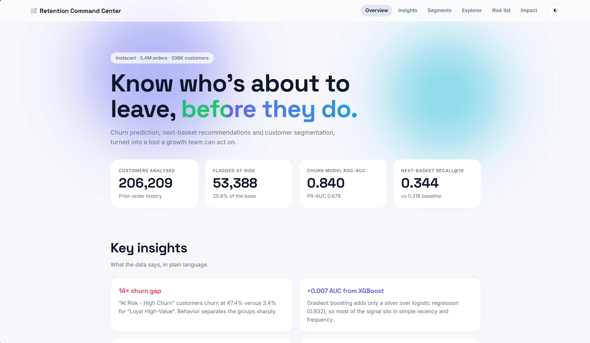
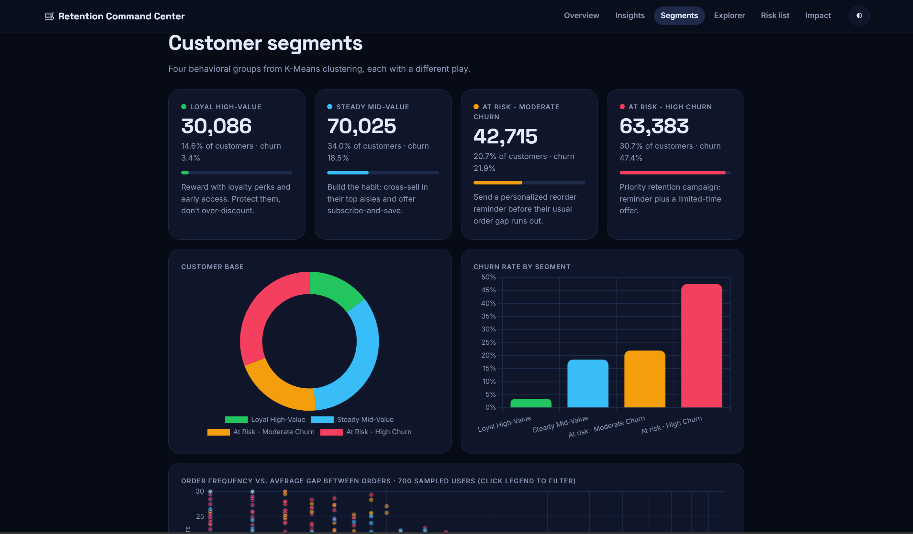
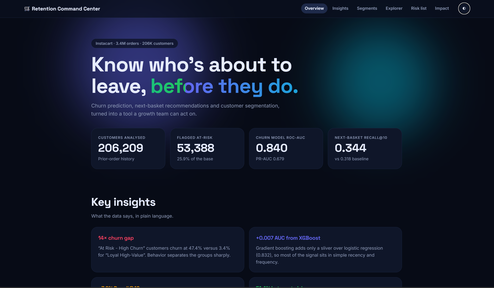

# Instacart Growth & Retention Intelligence

**End-to-end data science project: churn prediction, next-basket recommendation and customer segmentation on 3.4M Instacart orders.**

**[▶ Live Dashboard](https://Givenerlo969.github.io/instacart-growth-retention/)** · [Notebook](notebook/instacart_analysis.ipynb)



<table>
  <tr>
    <td width="50%"></td>
    <td width="50%"></td>
  </tr>
  <tr>
    <td align="center"><sub>Customer segments</sub></td>
    <td align="center"><sub>Dark mode</sub></td>
  </tr>
</table>

---

## Business Context

Instacart grows through repeat purchases, not one-time orders. This project answers three questions a retention team would actually ask:

1. **Who is about to stop ordering?** (Churn prediction)
2. **What will they buy next?** (Next-basket recommendation)
3. **Who deserves loyalty investment, and who needs a nudge?** (Customer segmentation)

Instead of the usual association-rule market-basket analysis, the work is framed around retention decisions and ends in an interactive dashboard.

---

## Key Results

| Task | Model | Metric | Result |
|---|---|---|---|
| Churn prediction | XGBoost | ROC-AUC | **0.840** |
| Churn prediction | XGBoost | PR-AUC | **0.679** (about 2.6x the 0.259 no-skill baseline) |
| Churn prediction | Logistic Regression (baseline) | ROC-AUC | 0.832 |
| Next-basket | Recency-weighted + reorder probability | Recall@10 | **0.344** (baseline 0.318) |
| Next-basket | Recency-weighted + reorder probability | NDCG@10 | **0.417** (baseline 0.386) |
| Segmentation | K-Means, k=4 | Silhouette | about 0.23 (estimated on a 10,000-user sample) |

### Customer segments (206,209 users)

| Segment | Users | Share | Churn rate |
|---|---|---|---|
| Loyal High-Value | 30,086 | 14.6% | 3.4% |
| Steady Mid-Value | 70,025 | 34.0% | 18.5% |
| At Risk - Moderate Churn | 42,715 | 20.7% | 21.9% |
| At Risk - High Churn | 63,383 | 30.7% | 47.4% |

### What the data says

- Churn is sharply segmented: the highest-risk group churns at about 14x the rate of the loyal group.
- XGBoost adds only about +0.007 ROC-AUC over logistic regression, so most of the signal sits in simple recency and frequency features.
- Recency-weighted recommendations beat a popularity baseline by roughly 8%, which means recent habits predict better than lifetime counts.

### Simulated business impact

With disclosed, illustrative assumptions (AOV $55, 12 orders per year if retained, 20% campaign success rate, $3 cost per targeted user), a churn-targeted campaign shows a net impact of about **$6.9M per year**. This is a simulation to demonstrate the reasoning, not a revenue claim.

---

## Dashboard

An interactive, single-file web dashboard (`index.html`) with:

- animated KPIs and key insights
- segment cards, composition and churn charts, and a sampled customer scatter plot
- a customer explorer with churn-risk gauge and comparison against the segment average
- a sortable churn risk list with segment filters
- an impact simulator with live sliders

It runs in any browser with no install. Data is embedded in the file.

---

## Dataset

Source: [Instacart Market Basket Analysis on Kaggle](https://www.kaggle.com/datasets/psparks/instacart-market-basket-analysis)

The raw data (about 1.4 GB, 6 CSV files) is **not included** in this repository. To reproduce the analysis, download it from the link above and place the files where `DATA_DIR` points (see below).

---

## Project Structure

```
instacart-growth-retention/
├── README.md
├── requirements.txt
├── .gitignore
├── index.html                      # interactive dashboard
├── notebook/
│   └── instacart_analysis.ipynb    # full analysis with outputs
└── images/
    └── dashboard.png
```

---

## Methodology

1. **Validation:** referential integrity across all tables (no orphan keys, no duplicates, all ranges valid). Missing `days_since_prior_order` values are exactly users' first orders.
2. **Feature engineering:** RFM-style features (with a proxy for monetary value, since the dataset has no prices), reorder ratio, order-timing consistency, basket-size trend and aisle diversity (Shannon entropy).
3. **Churn definition:** `eval_set` (train/test) is a Kaggle competition split artifact and cannot signal churn, so churn is defined from the gap since a user's last order. Thresholds of 14, 21 and 30 days were compared before choosing the final one. The feature used to build the label is excluded from the model inputs to avoid leakage.
4. **Churn modelling:** logistic regression baseline vs. XGBoost (class imbalance handled with `scale_pos_weight`), evaluated with ROC-AUC, PR-AUC, confusion matrix and SHAP.
5. **Next-basket:** a first-order Markov chain underperformed a popularity baseline and was replaced by a recency-weighted approach combined with personal reorder probability.
6. **Segmentation:** K-Means validated with both the elbow method and silhouette score. The statistically best k differs from the k chosen for business usefulness, and that trade-off is documented in the notebook.
7. **Business translation:** a revenue-impact simulation and a synthetic A/B test, both clearly labelled as simulations.

---

## Limitations

- The dataset has no prices, so "monetary" value is a proxy (basket size and reorder rate), not real spend.
- The churn label is a constructed proxy (days since last order), not ground truth.
- `days_since_prior_order` is capped at 30 in the source data, so 30 means "30 days or more".
- Churn probabilities in the dashboard are computed for all users, including those used to train the model, so they are slightly optimistic. Model performance is reported only on the held-out test set.
- Revenue figures and the A/B test are simulations built on illustrative assumptions.

---

## Tech Stack

Python · pandas · NumPy · scikit-learn · XGBoost · SHAP · matplotlib · seaborn · HTML/CSS/JavaScript · Chart.js

---

## How to Run the Notebook

**Option A: Google Colab**

1. Download the dataset from Kaggle and upload the 6 CSV files to a folder in Google Drive (for example `MyDrive/project`).
2. Open `notebook/instacart_analysis.ipynb` in Colab.
3. In the setup cell, set `DATA_DIR` to your Drive folder, then choose Runtime → Run all.

**Option B: Local**

```bash
git clone https://github.com/Givenerlo969/instacart-growth-retention.git
cd instacart-growth-retention
pip install -r requirements.txt
```

Place the CSV files in a `data/` folder, set `DATA_DIR = "data"` in the setup cell, and run the notebook in Jupyter or VS Code. The full dataset is large (32M rows in one table), so about 12 GB of RAM is recommended.

---

## Author

**Yesa Putra Giventta** · Data Science student, Universitas Airlangga · [LinkedIn](https://www.linkedin.com/in/yesa-putra-giventta-338429323/) · [GitHub](https://github.com/Givenerlo969)
